# Documentación Técnica — Sistema RUTEC

**Registro Único de Trabajadores Extranjeros en Colombia (RUTEC) — Ministerio del Trabajo**

Versión modernizada de la aplicación legacy, construida como SPA Angular + API REST .NET con autenticación JWT, compartiendo la capa de autenticación y los usuarios con el sistema RUE.

---

## 1. Visión general

El proyecto `rutec-new` es una **aplicación cliente/servidor desacoplada** compuesta por:

- **Frontend SPA** desarrollado en **Angular 21** con **PrimeNG 21** (tema Aura índigo, identidad Mintrabajo).
- **Backend Web API** desarrollado en **.NET (ASP.NET Core)** con arquitectura por capas (Domain / Application / Infrastructure / WebApi).
- **Persistencia** en **SQL Server** con **tres bases de datos**:
  - `RUTEC` — datos del negocio (trabajadores, contratos, verificaciones, certificados).
  - `AS_DB_RUE` — autenticación (compartida con RUE) mediante ASP.NET Identity.
  - `RUE` — **solo lectura**, para consultar organizaciones/empresas ya registradas en el sistema RUE.
- **Autenticación** mediante **`Shared.Auth`** (Identity + JWT + Refresh Tokens) — los usuarios son los mismos que los de RUE.
- **Generación de certificados** y **reportes** propios del módulo (`ICertificadoService`, `IReporteService`).
- **Módulo de calidad / verificación** para asignar contratos a verificadores y registrar verificaciones.

### Arquitectura general del sistema

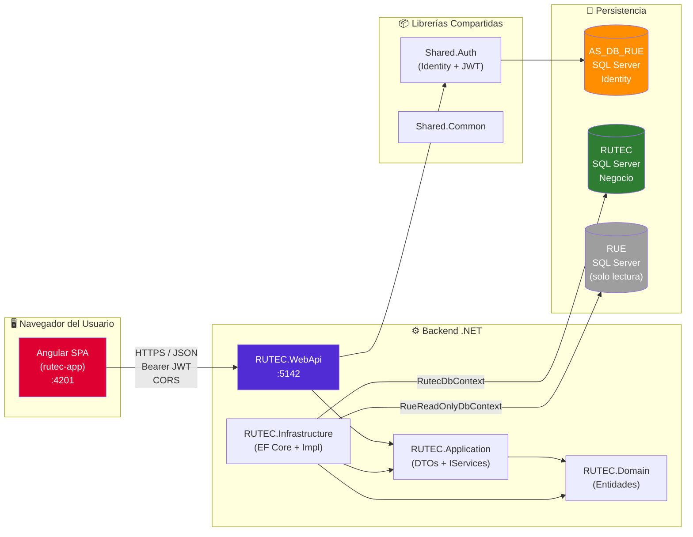

> **Nota:** RUE y RUTEC son aplicaciones gemelas que comparten Identity (mismo `AS_DB_RUE`) pero usan bases y APIs independientes. Los usuarios creados en una pueden autenticarse en la otra siempre que tengan el rol correspondiente.

---

## 2. Estructura de carpetas del repositorio

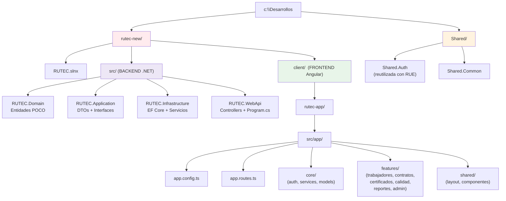

---

## 3. Backend — RUTEC.WebApi (.NET)

### 3.1 Arquitectura por capas (Clean Architecture)

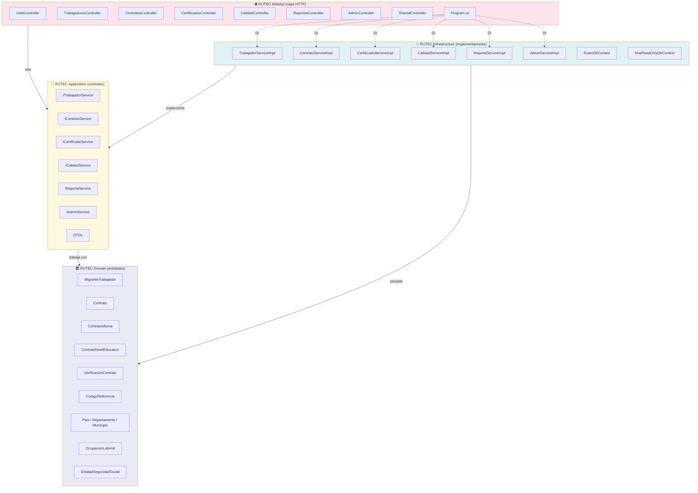

### 3.2 Punto de entrada — `Program.cs`

[src/RUTEC.WebApi/Program.cs](src/RUTEC.WebApi/Program.cs) registra:

- **Serilog** desde configuración.
- **`AddSharedAuth(...)`** → Identity + JWT (librería compartida con RUE).
- **Dos DbContext de EF Core:**
  - `RutecDbContext` sobre la cadena `RutecConnection` (BD `RUTEC`, escritura).
  - `RueReadOnlyDbContext` sobre la cadena `RueConnection` (BD `RUE`, **solo lectura** — para mostrar empresas/organizaciones del RUE en pantallas del módulo Calidad y Admin).
- DI de servicios de aplicación (scoped):

| Interfaz | Implementación |
|----------|----------------|
| `ITrabajadorService` | `TrabajadorServiceImpl` |
| `IContratoService`   | `ContratoServiceImpl` |
| `ICalidadService`    | `CalidadServiceImpl` |
| `IReporteService`    | `ReporteServiceImpl` |
| `IAdminService`      | `AdminServiceImpl` |
| `ICertificadoService`| `CertificadoServiceImpl` |

- **CORS policy `"Angular"`** que habilita `http://localhost:4201` con credenciales.
- **Swagger** (solo en Development).
- **Seeding automático** al arrancar:
  - Crea roles propios de RUTEC: `Admin`, `Usuario`, `Verificador`.
  - Crea/asegura usuario administrador `admin@mintrabajo.gov.co` / `Admin1234`.
  - Migra usuarios legacy desde `aspnet_Membership` siguiendo el mismo patrón que RUE (compatibilidad SHA1 vía `PasswordMigrationHasher`).

### 3.3 Configuración — `appsettings.json`

| Clave | Valor |
|-------|-------|
| `ConnectionStrings.AuthConnection` | BD **AS_DB_RUE** (Identity, compartida con RUE) |
| `ConnectionStrings.RutecConnection`| BD **RUTEC** (dominio del negocio) |
| `ConnectionStrings.RueConnection`  | BD **RUE** (solo lectura, empresas) |
| `Jwt.Issuer` / `Jwt.Audience`      | `RUTEC.WebApi` / `RUTEC.Angular` |
| `Jwt.AccessTokenExpirationMinutes` | **15 min** |
| `Jwt.RefreshTokenExpirationDays`   | **7 días** |
| `Email.SmtpHost`                   | `smtp.office365.com:587` |
| **Puerto HTTP**                    | `http://localhost:5142` (`launchSettings.json`) |

### 3.4 Controllers (rutas REST)

**Base URL en desarrollo:** `http://localhost:5142`

#### `AuthController` — `/api/auth`

| Método | Ruta | Auth | Descripción |
|--------|------|------|-------------|
| POST | `/api/auth/login` | Anon | Login → `{ accessToken, refreshToken, usuario }` |
| POST | `/api/auth/refresh-token` | Anon | Renueva access token |
| POST | `/api/auth/change-password` | JWT | Cambia contraseña (marca usuario migrado) |
| GET  | `/api/auth/me` | JWT | Info del usuario autenticado |

#### `TrabajadoresController` — `/api/trabajadores`

| Método | Ruta | Descripción |
|--------|------|-------------|
| GET  | `/api/trabajadores` | Listado paginado con filtros |
| GET  | `/api/trabajadores/{id}` | Detalle de un trabajador migrante |
| GET  | `/api/trabajadores/buscar?cedula=` | Búsqueda rápida por documento |
| POST | `/api/trabajadores` | Crear nuevo trabajador |
| PUT  | `/api/trabajadores/{id}` | Modificar datos |
| PUT  | `/api/trabajadores/{id}/documento` | Modificar documento de identidad |

#### `ContratosController` — `/api/trabajadores/{trabajadorId}/contratos`

| Método | Ruta | Descripción |
|--------|------|-------------|
| GET    | `…/contratos` | Lista todos los contratos del trabajador |
| GET    | `…/contratos/{id}` | Detalle del contrato (idiomas, niveles educativos) |
| POST   | `…/contratos` | Crea contrato |
| PUT    | `…/contratos/{id}` | Modifica contrato |
| PUT    | `…/contratos/{id}/finalizar` | Marca contrato como finalizado |
| DELETE | `…/contratos/{id}` | Elimina contrato con motivo |

#### `CertificadosController` — `/api/certificados`

| Método | Ruta | Descripción |
|--------|------|-------------|
| GET | `/api/certificados/trabajador/{trabajadorId}` | Lista certificados emitibles |
| GET | `/api/certificados/info/{contratoId}` | Datos previos al certificado |
| GET | `/api/certificados/generar/{contratoId}` | Genera y descarga el certificado |

#### `CalidadController` — `/api/calidad` (módulo de verificación)

| Método | Ruta | Descripción |
|--------|------|-------------|
| GET    | `/api/calidad/empresas` | Empresas con contratos a verificar |
| GET    | `/api/calidad/empresas/pendientes` | Empresas con verificaciones pendientes |
| GET    | `/api/calidad/empresas/aprobadas` | Empresas ya aprobadas |
| GET    | `/api/calidad/empresas/{idOrg}/contratos` | Contratos de la empresa |
| GET    | `/api/calidad/verificadores` | Lista de verificadores |
| GET    | `/api/calidad/verificador/{usuario}/contratos` | Contratos asignados al verificador |
| POST   | `/api/calidad/contratos/{contratoId}/verificador` | Asigna verificador a un contrato |
| GET    | `/api/calidad/contratos-gestion` | Bandeja de gestión |
| GET    | `/api/calidad/contrato-detalle/{contratoId}` | Detalle para verificar |
| GET    | `/api/calidad/motivos-aclaracion` | Catálogo de motivos |
| POST   | `/api/calidad/contratos/{contratoId}/verificacion` | Registra resultado de verificación |
| DELETE | `/api/calidad/verificacion/{id}` | Elimina una verificación |
| GET    | `/api/calidad/contratos-disponibles-count` | Contador para asignación |
| GET    | `/api/calidad/usuarios-admin` | Usuarios con rol Admin/Verificador |
| POST   | `/api/calidad/asignar-contratos-masivo` | Asignación masiva |
| POST   | `/api/calidad/asignar-contrato-unico` | Asignación individual |

#### `ReportesController` — `/api/reportes`

Endpoints `GET` para los reportes: `general`, `genero`, `nacionalidad`, `nivel-academico`, `sector-economico`, `zona`, `ano-nacimiento`, `empresas-registradas`, `cantidad-trabajadores`, `rue-general`, `rue-dia`, `gestion-general`, `gestion-dia`, `dashboard`, `dashboard-rue`, `exportar-excel`.

#### `AdminController` — `/api/admin`

| Recurso | Operaciones |
|---------|-------------|
| `usuarios` | GET listado, GET detalle |
| `codigos-referencia` | GET / POST / PUT / DELETE (catálogos del sistema) |
| `empresas` | GET listado (vía `RueReadOnlyDbContext`), GET contratos de una empresa |
| `contratos/{id}` | GET, GET full, PUT fechas |
| `registros/masivo` | DELETE |
| `eliminacion/{contratos\|trabajadores\|idiomas\|niveles}` | GET listado, DELETE individual |

#### `SharedController` — `/api/shared` (catálogos)

`GET` para: `departamentos`, `municipios`, `paises`, `codigos-referencia`, `ocupaciones-laborales`, `entidades-seguridad-social`, `mi-organizacion`, `organizacion/{idOrganizacion}`.

### 3.5 Autenticación — `Shared.Auth` (compartida con RUE)

Idéntica a la del proyecto RUE:

- **ASP.NET Core Identity** sobre `AuthDbContext` (cadena `AuthConnection` → `AS_DB_RUE`).
- **Reglas de contraseña**: mínimo 6 caracteres, exige dígito y minúscula; email único; bloqueo a los 5 intentos por 15 minutos.
- **`PasswordMigrationHasher`** para hashes legacy SHA1+salt.
- **JWT Bearer**: issuer `RUTEC.WebApi`, audience `RUTEC.Angular`, expiración 15 min, refresh 7 días.
- **`JwtTokenService`** persiste refresh tokens en `AuthDbContext.RefreshTokens` para revocación.

> Los **roles** son específicos de cada aplicación (`Aplicacion = "RUTEC"`): `Admin`, `Usuario`, `Verificador`. Un mismo usuario puede tener roles distintos en RUE y en RUTEC.

---

## 4. Frontend — rutec-app (Angular)

### 4.1 Stack y bootstrap

[client/rutec-app/src/app/app.config.ts](client/rutec-app/src/app/app.config.ts) configura:

- `provideRouter(routes)` con rutas lazy-load y `authGuard`.
- `provideHttpClient(withInterceptors([jwtInterceptor]))` — todas las peticiones HTTP pasan por el interceptor JWT.
- `providePrimeNG(...)` con preset Aura customizado en índigo (Mintrabajo).

### 4.2 Conexión al backend (sin proxy)

A diferencia de RUE, RUTEC **no usa `proxy.conf.json`**: el frontend apunta directamente al backend mediante URL absoluta.

[client/rutec-app/src/app/core/services/api.service.ts](client/rutec-app/src/app/core/services/api.service.ts):

```typescript
@Injectable({ providedIn: 'root' })
export class ApiService {
  readonly baseUrl = 'http://localhost:5142/api';
}
```

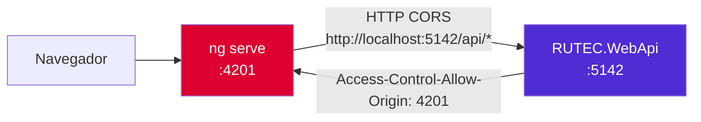

La comunicación cruzada se habilita gracias al policy CORS `"Angular"` declarado en `Program.cs`.

### 4.3 Capa `core/`

| Archivo | Responsabilidad |
|---------|----------------|
| `core/services/api.service.ts` | Expone `baseUrl` absoluta del backend |
| `core/services/trabajadores.service.ts` | HTTP de trabajadores |
| `core/services/contratos.service.ts` | HTTP de contratos |
| `core/services/certificados.service.ts` | HTTP de certificados |
| `core/services/calidad.service.ts` | HTTP del módulo Calidad / Verificación |
| `core/services/reportes.service.ts` | HTTP de reportes |
| `core/services/admin.service.ts` | HTTP del módulo Admin |
| `core/services/shared.service.ts` | Catálogos (`/api/shared/*`) |
| `core/auth/auth.service.ts` | Login/logout, tokens en `localStorage`, estado reactivo con `signal()` |
| `core/auth/jwt.interceptor.ts` | Inyecta `Authorization: Bearer <token>` y auto-refresh ante 401 |
| `core/auth/auth.guard.ts` | `authGuard` para rutas protegidas |

### 4.4 Mapa de rutas

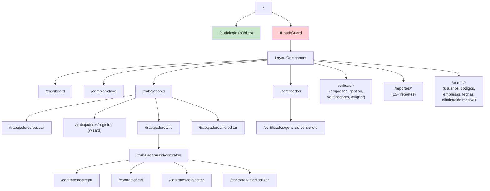

Todas las rutas usan `loadComponent` (code-splitting).

### 4.5 Features

Cada subcarpeta de `client/rutec-app/src/app/features` representa un módulo funcional:

| Feature | Responsabilidad |
|---------|----------------|
| `auth/` | Login y cambio de clave |
| `dashboard/` | Tablero principal |
| `trabajadores/` | CRUD de trabajadores migrantes (lista, búsqueda, registro wizard, resumen, edición) |
| `contratos/` | Gestión de contratos por trabajador (lista, formulario, detalle, finalización) |
| `certificados/` | Generación y listado de certificados |
| `calidad/` | Módulo de verificación: empresas, gestión, verificadores, asignación, detalle |
| `reportes/` | 15+ reportes estadísticos (dashboard, género, nacionalidad, zona, etc.) |
| `admin/` | Administración: usuarios, códigos de referencia, empresas RUTEC, modificación de fechas, eliminación masiva |

---

## 5. Interacción Frontend ↔ Backend

### 5.1 Flujo de autenticación (login + uso del token + refresh)

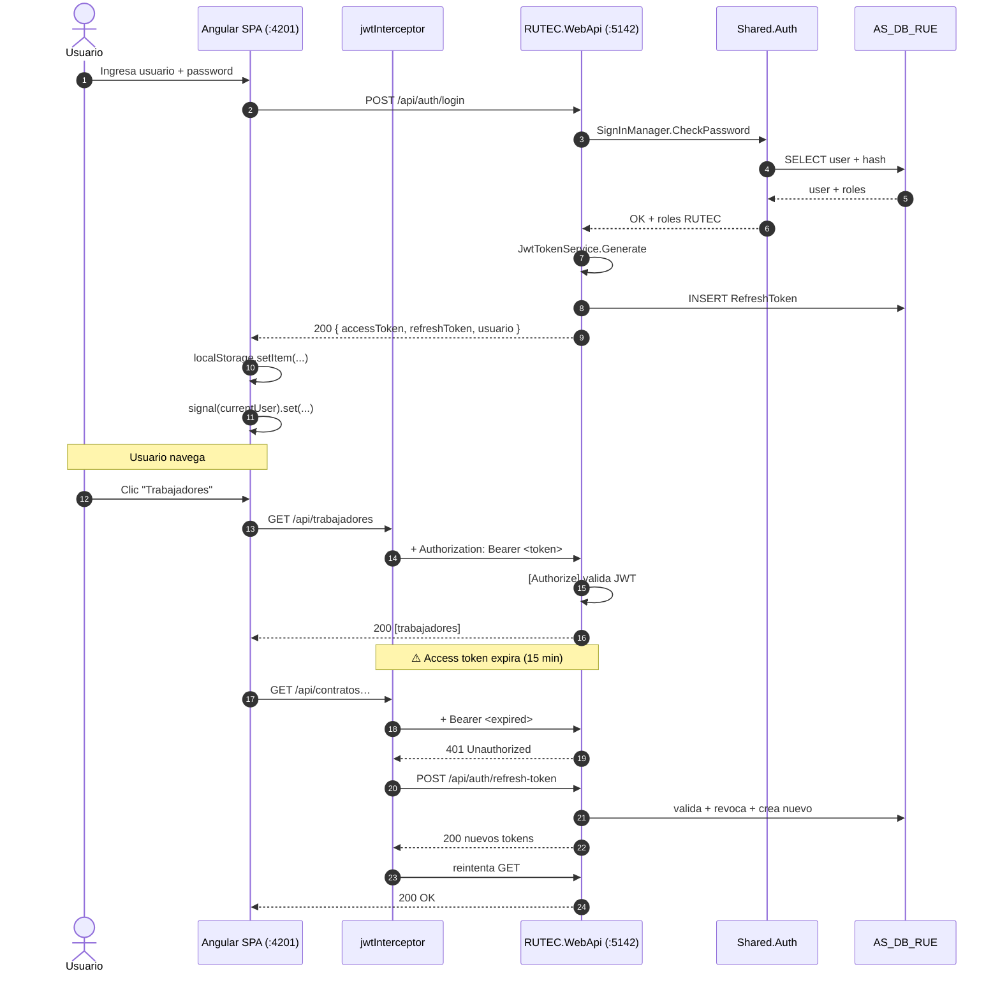

### 5.2 Ciclo de vida de un trabajador y su contrato

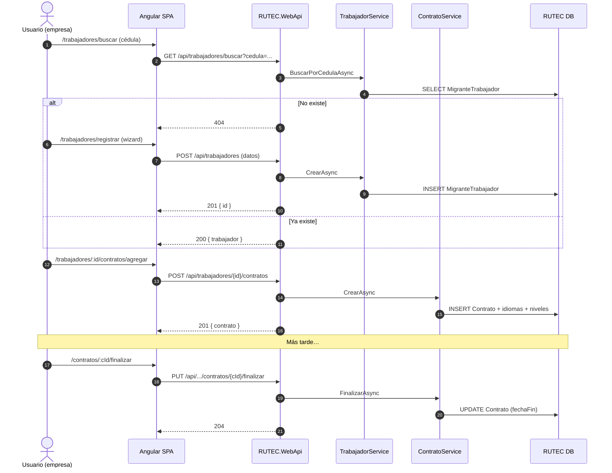

### 5.3 Flujo de verificación de calidad

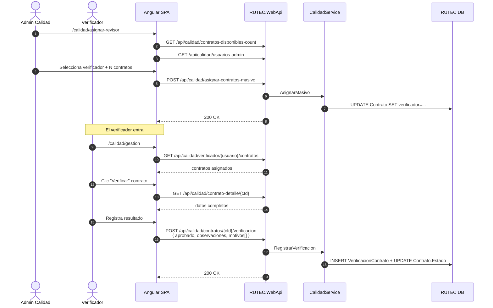

### 5.4 Generación de certificado

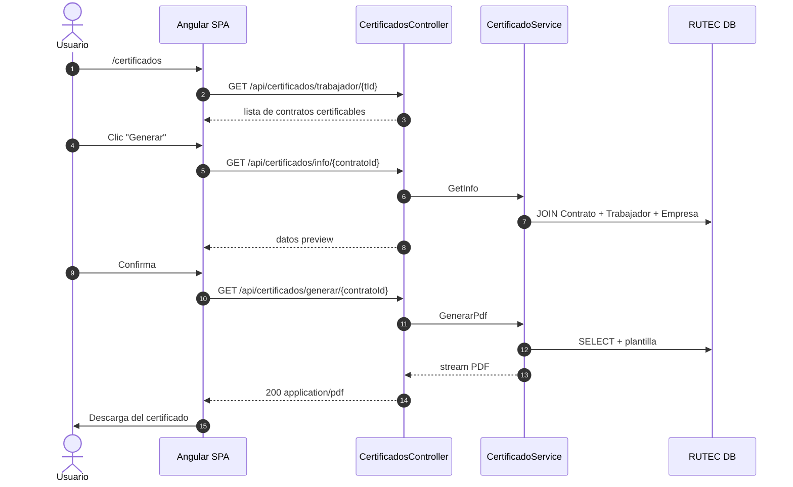

### 5.5 Resumen de la conversación HTTP

| Aspecto | Configuración |
|---------|---------------|
| **URL base front (dev)** | `http://localhost:4201` |
| **URL base API (dev)**   | `http://localhost:5142` |
| **Mecanismo dev**        | **Sin proxy** — URL absoluta + CORS |
| **CORS**                 | Policy `Angular` permite `http://localhost:4201` con `AllowCredentials` |
| **Formato**              | JSON (excepto `application/pdf` en certificados y `application/vnd.openxmlformats-officedocument…` en exportar-excel) |
| **Auth**                 | JWT Bearer (Header `Authorization`), refresh dedicado |
| **Documentación API**    | Swagger UI en `http://localhost:5142/swagger` (Development) |

---

## 6. Modelo de datos (alto nivel)

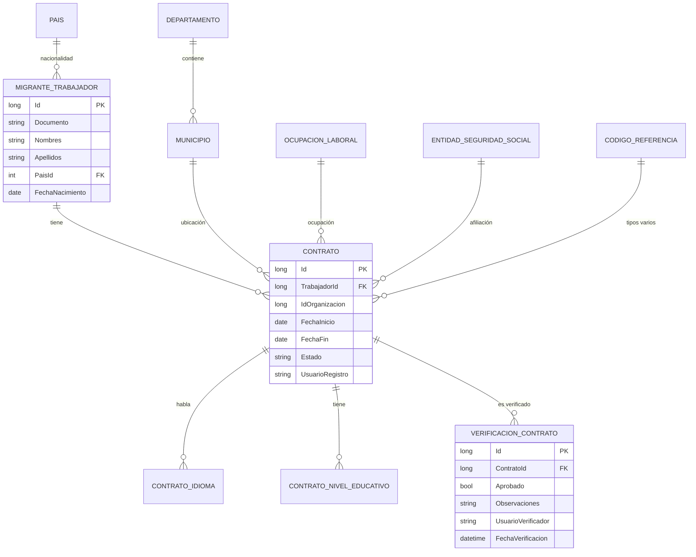

| Base | Cadena | Acceso | Contenido |
|------|--------|--------|-----------|
| **AS_DB_RUE** | `AuthConnection` | Lectura/Escritura | Identity (compartido con RUE) |
| **RUTEC** | `RutecConnection` | Lectura/Escritura | `MigranteTrabajador`, `Contrato`, `ContratoIdioma`, `ContratoNivelEducativo`, `VerificacionContrato`, `CodigoReferencia`, `Pais`, `Departamento`, `Municipio`, `OcupacionLaboral`, `EntidadSeguridadSocial` |
| **RUE** | `RueConnection` | **Solo lectura** (`RueReadOnlyDbContext`) | Tablas de organizaciones del sistema RUE consultadas para enriquecer pantallas de empresas en RUTEC |

---

## 7. Pipeline HTTP del backend

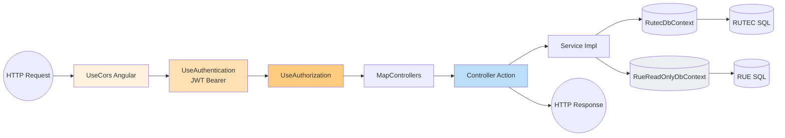

---

## 8. Relación RUE ↔ RUTEC

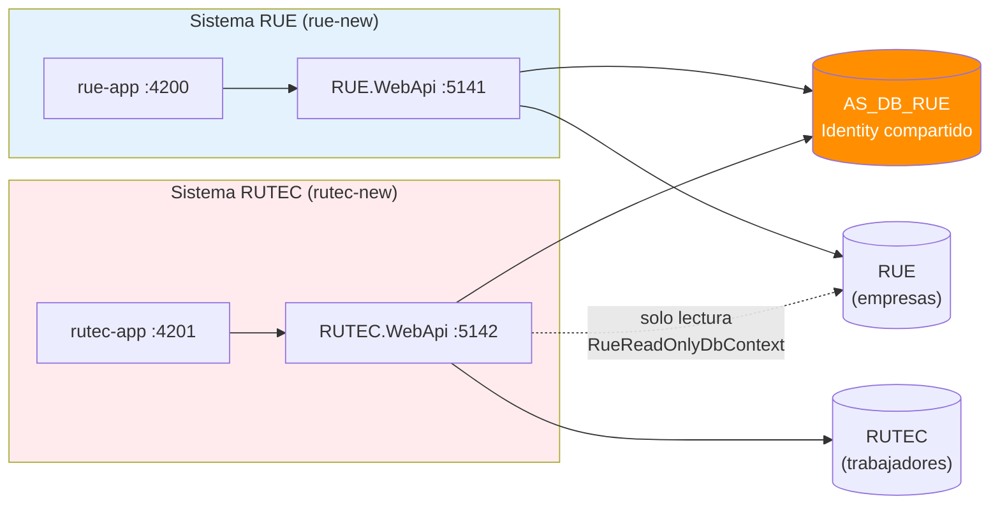

- Ambas APIs **comparten** la base `AS_DB_RUE` y la librería `Shared.Auth` para login.
- Los **roles** son por aplicación (`Aplicacion = "RUE"` o `Aplicacion = "RUTEC"`), por lo que un mismo usuario puede tener permisos distintos en cada sistema.
- RUTEC **consume datos de RUE** mediante `RueReadOnlyDbContext` para listar empresas registradas.

---

## 9. Cómo ejecutar el sistema en local

### 9.1 Backend

```powershell
cd c:\Desarrollos\rutec-new\src\RUTEC.WebApi
dotnet run --launch-profile http
# Escucha en http://localhost:5142
# Swagger en http://localhost:5142/swagger
```

### 9.2 Frontend

```powershell
cd c:\Desarrollos\rutec-new\client\rutec-app
npm install        # primera vez
npx ng serve --port 4201
# Disponible en http://localhost:4201
```

> El backend **debe estar corriendo antes** que el frontend porque las llamadas son por URL absoluta (sin proxy).

### 9.3 Credenciales por defecto (seed)

- **Admin:** `admin@mintrabajo.gov.co` / `Admin1234` (rol Admin RUTEC)
- **Legacy:** `79835450` / `Urz7Cd` (rol Admin)

---

## 10. Tecnologías y versiones

| Componente | Tecnología | Versión |
|------------|------------|---------|
| Frontend | Angular | 21.2 |
| UI | PrimeNG / PrimeUix Aura | 21.1 / 2.0 |
| Lenguaje front | TypeScript | 5.9 |
| Backend | ASP.NET Core | .NET 8/9 |
| ORM | Entity Framework Core (SQL Server provider) | — |
| Auth | ASP.NET Core Identity + JWT Bearer | — |
| Logging | Serilog | — |
| Email | SMTP (Office 365) | — |
| Base de datos | SQL Server | — |

---

## 11. Referencias rápidas

- Entrypoint backend: `src/RUTEC.WebApi/Program.cs`
- Configuración: `src/RUTEC.WebApi/appsettings.json`
- Login endpoint: `src/RUTEC.WebApi/Controllers/AuthController.cs`
- Trabajadores: `src/RUTEC.WebApi/Controllers/TrabajadoresController.cs`
- Contratos: `src/RUTEC.WebApi/Controllers/ContratosController.cs`
- Calidad: `src/RUTEC.WebApi/Controllers/CalidadController.cs`
- DbContext RUTEC: `src/RUTEC.Infrastructure/Data/RutecDbContext.cs`
- DbContext RUE (RO): `src/RUTEC.Infrastructure/Data/RueReadOnlyDbContext.cs`
- Bootstrap front: `client/rutec-app/src/app/app.config.ts`
- Rutas front: `client/rutec-app/src/app/app.routes.ts`
- API service: `client/rutec-app/src/app/core/services/api.service.ts`
- Shared Auth DI: `Shared/Shared.Auth/DependencyInjection.cs`

---

<div style="text-align:center; color:#666; font-size:0.9em; margin-top:40px;">
Documento generado automáticamente · Ministerio del Trabajo · Sistema RUTEC
</div>
