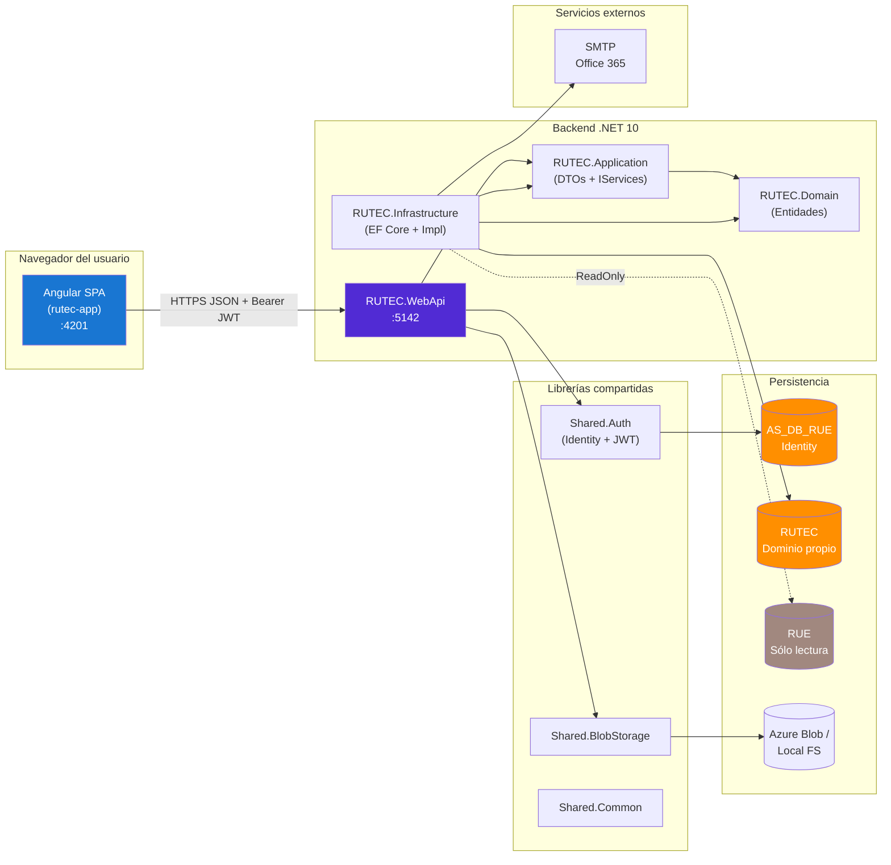
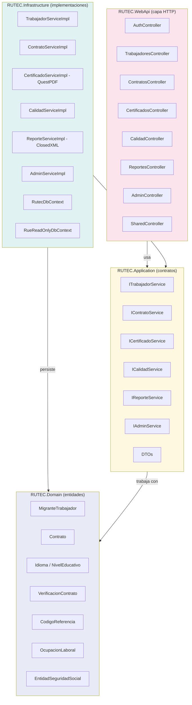
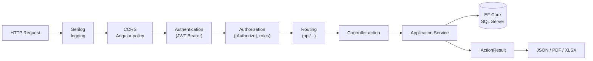
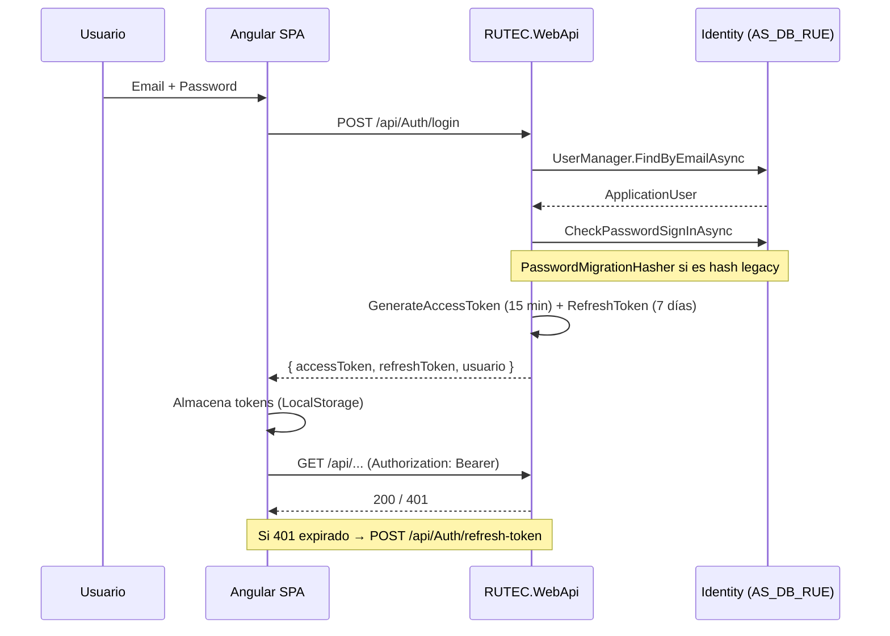
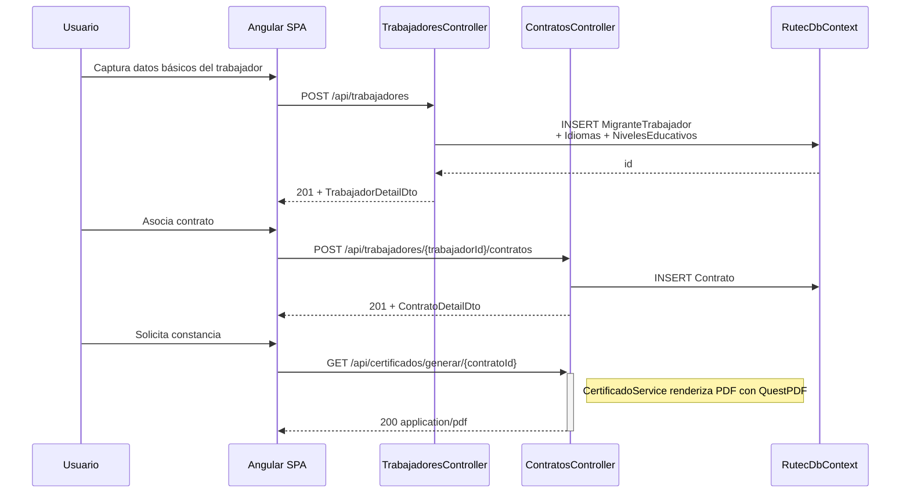
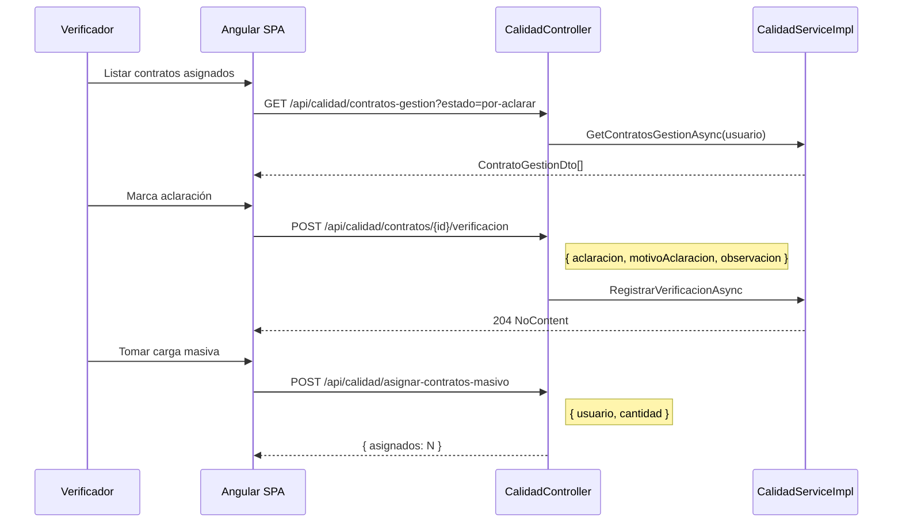

# Sistema RUTEC — Registro Único de Trabajadores Extranjeros con Contrato

**Ministerio del Trabajo · República de Colombia**

Documento técnico-funcional con descripción del proyecto, su stack tecnológico, patrones de diseño aplicados, arquitectura, módulos funcionales y catálogo de APIs REST.

---

## 1. Descripción del proyecto

El **Registro Único de Trabajadores Extranjeros con Contrato (RUTEC)** es el sistema institucional del Ministerio del Trabajo de Colombia mediante el cual las empresas empleadoras reportan, mantienen y certifican la información laboral de sus trabajadores extranjeros vinculados mediante contrato. RUTEC opera como módulo hermano de **RUE** (Registro Único de Empresas): RUE provee la identidad jurídica de la empresa empleadora, y RUTEC opera sobre esa identidad para gestionar el ciclo de vida del trabajador extranjero y su contrato.

El proyecto `rutec-new` corresponde a la **modernización** de la aplicación legacy en ASP.NET WebForms hacia una arquitectura desacoplada **SPA Angular + API REST .NET**, conservando el modelo de datos relacional histórico y unificando la autenticación con el resto de los módulos del Ministerio (RUE, CEN) a través de la librería compartida `Shared.Auth`.

### 1.1 Objetivos funcionales

| Objetivo | Descripción |
|---|---|
| Registro del trabajador extranjero | Capturar identificación (cédula de extranjería / pasaporte), nacionalidad, género, estado civil, fecha de nacimiento, idiomas y niveles educativos. |
| Gestión de contratos | Crear, modificar, finalizar y eliminar contratos vinculados a un trabajador, con vigencias, cargo, ocupaciones laborales (hasta 3) y entidades de seguridad social. |
| Generación de constancias | Emitir certificados PDF que constatan el registro del contrato del trabajador extranjero ante el Ministerio. |
| Verificación de calidad | Permitir que un funcionario verificador asigne aclaraciones a contratos, los marque como verificados, y gestione cargas de trabajo masivas. |
| Reportes operativos y gerenciales | Consultas analíticas por género, nacionalidad, nivel académico, sector económico, zona geográfica, año de nacimiento, cantidad de trabajadores por empresa, etc. Exportación XLSX. |
| Administración técnica | Gestionar usuarios, códigos de referencia, empresas y operaciones masivas de eliminación. |
| Catálogos compartidos | Servir departamentos, municipios, países, ocupaciones laborales (multiniveles), entidades de seguridad social y códigos de referencia. |

### 1.2 Alcance del proyecto

El sistema cubre cuatro dominios principales:

- **Captura y mantenimiento** de trabajadores extranjeros (`/trabajadores/*`).
- **Gestión de contratos** vinculados al trabajador (`/trabajadores/{id}/contratos/*`).
- **Verificación de calidad** y aclaraciones por funcionarios (`/calidad/*`).
- **Reportes** operativos y gerenciales, con exportación a Excel (`/reportes/*`).

Adicionalmente expone certificados PDF, administración técnica y catálogos compartidos cacheados.

### 1.3 Roles del sistema

| Rol | Permisos clave |
|---|---|
| `Admin` | Acceso total: usuarios, códigos de referencia, contratos, eliminaciones masivas, reportes. |
| `Verificador` | Asigna aclaraciones, gestiona su carga de contratos en `CalidadController`. |
| Usuarios autenticados | Captura y consulta de trabajadores y contratos asociados a su organización. |

La pertenencia se valida con `[Authorize(Roles = "Admin,Verificador")]` en módulos sensibles.

---

## 2. Descripción de la tecnología

### 2.1 Stack consolidado

| Capa | Tecnología | Versión / Detalle |
|---|---|---|
| **Frontend** | Angular | 21.x (`@angular/core ^21.2.0`) |
| | UI | PrimeNG 21 (tema Aura con preset MinTrabajo) |
| | Lenguaje | TypeScript 5.9 |
| | Build | `@angular/build` 21.2 (esbuild + Vite) |
| **Backend** | .NET | .NET 10 (`net10.0`) |
| | Web framework | ASP.NET Core MVC |
| | ORM | Entity Framework Core 10 |
| | Identity | ASP.NET Core Identity + JWT (`Shared.Auth`) |
| | Documentación | Swashbuckle (Swagger) |
| | Logging | Serilog |
| **Base de datos** | SQL Server | 3 bases: `AS_DB_RUE` (Identity), `RUTEC` (negocio), `RUE` (sólo lectura — datos de organización) |
| **Almacenamiento** | Azure Blob Storage / disco local | Vía `Shared.BlobStorage` (para soportes) |
| **Mail** | SMTP | Office 365 (`EmailService`) |
| **Reportes** | ClosedXML | Exportación XLSX por tipo |
| **PDF** | QuestPDF | Generación de **constancias** del contrato |
| **Compartido** | `Shared.Auth` | Identity + JWT + migración de passwords legacy |
| | `Shared.BlobStorage` | Abstracción de almacenamiento |
| | `Shared.Common` | Utilidades transversales |

### 2.2 Particularidad: dos `DbContext` en simultáneo

A diferencia de RUE, RUTEC necesita leer datos de la base RUE para enriquecer información de la organización empleadora. El proyecto inyecta dos contextos:

- `RutecDbContext` — lectura/escritura sobre BD `RUTEC` (entidades propias del módulo).
- `RueReadOnlyDbContext` — sólo lectura sobre BD `RUE` (`Organizaciones`, `Representantes`, `ActividadesEconomicas`, `CodigosReferencia`).

Esto se ve, por ejemplo, en `SharedController.GetDatosOrganizacion(...)` que consulta el contexto RUE para complementar el listado de empresas RUTEC con su razón social, actividad económica y representante legal.

### 2.3 Stack de desarrollo

- **IDE**: Visual Studio 2026 / VS Code.
- **Runtime local**: backend en `http://localhost:5142`, frontend en `http://localhost:4201` (conexión directa al backend, sin proxy).
- **Control de versiones**: Git.
- **Empaquetado del frontend**: `ng build` con presupuesto inicial controlado.
- **Documentación viva**: Swagger UI en `/swagger`.

### 2.4 Decisiones tecnológicas relevantes

- **Standalone Components (Angular 21)** con lazy loading por feature.
- **Signals + RxJS** para estado y flujos asíncronos.
- **JWT con Access + Refresh Token** (15 min / 7 días).
- **`Shared.Auth` compartida**: el mismo `JwtTokenService`, `ApplicationUser` y `PasswordMigrationHasher` que usan RUE y CEN.
- **`RueReadOnlyDbContext`** evita duplicación de catálogos y mantiene una única fuente de verdad sobre los datos de la empresa.

---

## 3. Descripción de los patrones de diseño

### 3.1 Patrones arquitectónicos

#### 3.1.1 Clean Architecture (capas con dependencias hacia el dominio)

```
RUTEC.WebApi  →  RUTEC.Application  ←  RUTEC.Infrastructure
                        ↓
                  RUTEC.Domain
```

#### 3.1.2 Repository / Unit of Work implícito

`RutecDbContext` y `RueReadOnlyDbContext` actúan simultáneamente como repositorios (DbSets) y unidad de trabajo (`SaveChangesAsync`). Los servicios consumen el contexto por DI scoped, respetando la unidad de trabajo por request HTTP.

#### 3.1.3 Bounded Context separado por base de datos

Cada `DbContext` modela un *bounded context* distinto: `RUTEC` (dominio propio) y `RUE` (dominio de organización, sólo lectura). Esto evita acoplamiento transversal y materializa el patrón de **integración por base de datos compartida** pero con dirección de lectura controlada.

#### 3.1.4 Dependency Injection (constructor injection)

Toda la composición se hace en `Program.cs` con `builder.Services.AddScoped<I..., ...Impl>()`. Controllers y servicios reciben dependencias por constructor.

#### 3.1.5 CQRS implícito (lectura vs escritura)

Los servicios separan consultas (`GetAllAsync`, `GetByIdAsync`, `GetEmpresasAsync`) de mutaciones (`CrearAsync`, `ModificarAsync`, `EliminarAsync`, `AsignarVerificadorAsync`).

### 3.2 Patrones tácticos / GoF

| Patrón | Aplicación en el código |
|---|---|
| **Strategy** | `JwtTokenService` desacopla el algoritmo de firma. `PasswordMigrationHasher` actúa como estrategia alterna para hashes legacy. La generación de PDF (`QuestPDF`) encapsula la lógica de renderizado por tipo de constancia. |
| **Factory Method** | DTOs construidos como `record` con constructor sintético — factories inmutables (`TrabajadorListDto`, `ContratoDetailDto`). |
| **DTO (Data Transfer Object)** | Cada entrada / salida HTTP cruza fronteras como `record`. |
| **Specification** | Los `*FiltroDto` (paginación + filtros) actúan como especificaciones que el servicio traduce a EF Core `Where`. |
| **Decorator (cross-cutting)** | `[Authorize]`, `[Authorize(Roles = "Admin")]`, `[Authorize(Roles = "Admin,Verificador")]`, `[ApiController]` decoran el pipeline ASP.NET. |
| **Template Method** | Controllers heredan de `ControllerBase`; el framework orquesta binding, validación y ejecución. |
| **Adapter** | `RueReadOnlyDbContext` adapta el modelo RUE para uso restringido desde RUTEC. |
| **Observer (caching)** | `IMemoryCache` con `SlidingExpiration` actúa como observador del TTL para invalidar entradas (departamentos, países, códigos de referencia). |

### 3.3 Patrones del frontend (Angular)

| Patrón | Aplicación |
|---|---|
| **Interceptor (Chain of Responsibility)** | `jwtInterceptor` añade el `Authorization: Bearer ...` y maneja refresh transparente ante 401. |
| **Guard (Strategy)** | `authMatchGuard` y `roleGuard(['Admin', 'Verificador'])` deciden si la ruta puede activarse. |
| **Smart vs Presentational Components** | Los `features/*` son *smart*; `shared/components/*` son *presentational*. |
| **Observer (RxJS / signals)** | Estado reactivo con `signal()`, `computed()` y `Observable`. |
| **Lazy Loading** | Cada ruta usa `loadComponent: () => import(...)`. |
| **Service Locator (inject)** | `inject(RutecApiService)` en lugar de constructores explícitos. |
| **Facade** | `RutecApiService` expone una fachada estable sobre `HttpClient`. |

---

## 4. Descripción de la arquitectura

### 4.1 Arquitectura general del sistema



### 4.2 Arquitectura por capas (Clean Architecture)



### 4.3 Pipeline HTTP del backend



### 4.4 Flujo de autenticación (compartido vía Shared.Auth)



### 4.5 Ciclo de vida del trabajador y su contrato



### 4.6 Verificación de calidad



---

## 5. Descripción de los módulos

### 5.1 Mapa general de módulos

| # | Módulo backend | Módulo frontend | Propósito |
|---|---|---|---|
| 1 | `AuthController` + `Shared.Auth` | `features/auth/` | Login, refresh token, cambio de contraseña, perfil. |
| 2 | `TrabajadoresController` + `TrabajadorServiceImpl` | `features/trabajadores/` | Captura y mantenimiento de trabajadores. |
| 3 | `ContratosController` + `ContratoServiceImpl` | `features/contratos/` | Gestión de contratos vinculados al trabajador. |
| 4 | `CertificadosController` + `CertificadoServiceImpl` (QuestPDF) | `features/certificados/` | Constancia PDF del contrato. |
| 5 | `CalidadController` + `CalidadServiceImpl` | `features/calidad/` | Verificación, aclaraciones y asignación masiva. |
| 6 | `ReportesController` + `ReporteServiceImpl` (ClosedXML) | `features/reportes/` | Reportes analíticos y exportes Excel. |
| 7 | `AdminController` + `AdminServiceImpl` | `features/admin/` | Usuarios, códigos de referencia, empresas, eliminaciones masivas. |
| 8 | `SharedController` | (consumido por formularios) | Catálogos: departamentos, municipios, países, ocupaciones laborales, entidades de seguridad social. |

### 5.2 Módulo de Autenticación

- **Identidad**: ASP.NET Core Identity sobre `ApplicationUser` con campos `NombreCompleto`, `Activo`, `PasswordMigrated`, `LegacyPasswordSalt`.
- **JWT**: `JwtTokenService` emite tokens con claims `NameIdentifier`, `Name`, `Email`, `Role`.
- **Refresh token**: persistido en `RefreshTokens` con `FechaCreacion`, `FechaExpiracion`, `FechaRevocacion`. Rotación al usarse.
- **Migración legacy**: `PasswordMigrationHasher` (heredado de `Shared.Auth`) valida hashes legacy SHA-1+salt y los re-hashea con Identity v3.
- **Seed inicial**: crea roles `Admin`, `Verificador`, `Usuario` y un admin inicial.

### 5.3 Módulo de Trabajadores

Mantenimiento del trabajador extranjero — entidad central del dominio.

| Acción | Endpoint |
|---|---|
| Listar (paginado / filtros) | `GET /api/trabajadores` |
| Buscar por cédula | `GET /api/trabajadores/buscar?cedula=` |
| Obtener detalle | `GET /api/trabajadores/{id}` |
| Crear trabajador | `POST /api/trabajadores` |
| Modificar datos | `PUT /api/trabajadores/{id}` |
| Modificar documento (CE / pasaporte) | `PUT /api/trabajadores/{id}/documento` |

### 5.4 Módulo de Contratos

Submodulo anidado bajo trabajador (`/api/trabajadores/{trabajadorId}/contratos`).

| Acción | Endpoint |
|---|---|
| Listar contratos del trabajador | `GET /api/trabajadores/{trabajadorId}/contratos` |
| Obtener contrato | `GET /api/trabajadores/{trabajadorId}/contratos/{id}` |
| Crear contrato | `POST /api/trabajadores/{trabajadorId}/contratos` |
| Modificar contrato | `PUT /api/trabajadores/{trabajadorId}/contratos/{id}` |
| Finalizar contrato | `PUT /api/trabajadores/{trabajadorId}/contratos/{id}/finalizar` |
| Eliminar contrato (con motivo) | `DELETE /api/trabajadores/{trabajadorId}/contratos/{id}` |

### 5.5 Módulo de Certificados

Generación de **constancias PDF** del contrato del trabajador.

| Acción | Endpoint |
|---|---|
| Listar certificados por trabajador | `GET /api/certificados/trabajador/{trabajadorId}` |
| Obtener info de contrato para certificado | `GET /api/certificados/info/{contratoId}` |
| **Generar PDF (descarga)** | `GET /api/certificados/generar/{contratoId}` |

El PDF se renderiza con **QuestPDF** y se devuelve como `application/pdf` directamente al cliente.

### 5.6 Módulo de Calidad (Verificación)

Reservado a roles `Admin` y `Verificador`. Permite asignar contratos a verificadores, registrar aclaraciones y gestionar carga de trabajo.

| Acción | Endpoint |
|---|---|
| Empresas (todas / pendientes / aprobadas) | `GET /api/calidad/empresas`, `/empresas/pendientes`, `/empresas/aprobadas` |
| Contratos de una empresa | `GET /api/calidad/empresas/{idOrganizacion}/contratos` |
| Listar verificadores | `GET /api/calidad/verificadores` |
| Asignar verificador a contrato | `POST /api/calidad/contratos/{contratoId}/verificador` |
| Gestión por estado y verificador | `GET /api/calidad/contratos-gestion?estado=&verificador=` |
| Contratos de un verificador | `GET /api/calidad/verificador/{usuario}/contratos` |
| Eliminar verificación | `DELETE /api/calidad/verificacion/{id}` |
| Detalle de contrato para verificación | `GET /api/calidad/contrato-detalle/{contratoId}` |
| Motivos de aclaración | `GET /api/calidad/motivos-aclaracion` |
| Registrar verificación / aclaración | `POST /api/calidad/contratos/{contratoId}/verificacion` |
| Contratos disponibles (conteo) | `GET /api/calidad/contratos-disponibles-count` |
| Listar usuarios admin RUTEC | `GET /api/calidad/usuarios-admin` |
| Asignar carga masiva | `POST /api/calidad/asignar-contratos-masivo` |
| Asignar contrato único | `POST /api/calidad/asignar-contrato-unico` |

### 5.7 Módulo de Reportes

Subdividido en reportes analíticos del dominio RUTEC, reportes cruzados con RUE y exportes Excel.

- **Distribuciones**: `/general`, `/genero`, `/nacionalidad`, `/nivel-academico`, `/sector-economico`, `/zona`, `/ano-nacimiento`.
- **Empresas**: `/empresas-registradas`, `/cantidad-trabajadores`.
- **Vista cruzada con RUE**: `/rue-general`, `/rue-dia`, `/gestion-general`, `/gestion-dia`.
- **Dashboards**: `/dashboard?fechaDesde=&fechaHasta=&pais=`, `/dashboard-rue?...`.
- **Exportación XLSX**: `GET /api/reportes/exportar-excel?tipo={tipo}` con ClosedXML.

### 5.8 Módulo de Administración

Operaciones reservadas a `Admin`.

| Subdominio | Endpoint base |
|---|---|
| Usuarios | `GET /api/admin/usuarios`, `GET /api/admin/usuarios/{id}` |
| Códigos de referencia | `GET/POST/PUT/DELETE /api/admin/codigos-referencia` |
| Empresas RUTEC | `GET /api/admin/empresas`, `GET /api/admin/empresas/{idOrganizacion}/contratos` |
| Contratos | `GET /api/admin/contratos/{id}`, `/contratos/{id}/full`, `PUT /api/admin/contratos/{id}/fechas` |
| Eliminación masiva | `DELETE /api/admin/registros/masivo` |
| Eliminación individual (listar + borrar) | `/api/admin/eliminacion/{contratos|trabajadores|idiomas|niveles}` |

### 5.9 Catálogos compartidos

`SharedController` expone catálogos cacheados con `IMemoryCache` (TTL 1 h):

- `GET /api/Shared/departamentos`
- `GET /api/Shared/municipios?depto=`
- `GET /api/Shared/paises`
- `GET /api/Shared/codigos-referencia?grupo=`
- `GET /api/Shared/ocupaciones-laborales?nivel=&padre=`
- `GET /api/Shared/entidades-seguridad-social?tipo=`
- `GET /api/Shared/mi-organizacion` (organización derivada del primer trabajador en RUTEC)
- `GET /api/Shared/organizacion/{idOrganizacion}` (datos de la organización desde **`RueReadOnlyDbContext`** + actividad económica + representante legal).

### 5.10 Frontend (Angular)

| Feature | Ruta | Componente principal | Función |
|---|---|---|---|
| Login | `/auth/login` | `LoginComponent` | Autenticación pública |
| Dashboard | `/dashboard` | `DashboardComponent` | KPIs y gráficos |
| Trabajadores | `/trabajadores/...` | `TrabajadorListComponent`, `TrabajadorDetailComponent`, `TrabajadorFormComponent` | Captura y mantenimiento |
| Contratos | (anidado en trabajador) | `ContratoListComponent`, `ContratoFormComponent` | Gestión contractual |
| Certificados | `/certificados/...` | `CertificadoComponent` | Vista previa y descarga PDF |
| Calidad | `/calidad/...` | `VerificacionListComponent`, `AclaracionFormComponent` | Bandeja del verificador |
| Reportes | `/reportes/...` | `ReporteDashboardComponent`, `ExportComponent` | Visualización y export |
| Administración | `/admin/...` | `UsuariosAdminComponent`, `CodigosReferenciaComponent`, `EliminacionMasivaComponent` | Backoffice |

---

## 6. Descripción de los APIs

Todos los endpoints viven bajo el prefijo `/api/...`. Salvo indicación contraria, requieren `Authorization: Bearer <accessToken>`. Algunos requieren rol específico vía `[Authorize(Roles = "...")]`.

Convenciones:
- Respuestas exitosas: `200 OK`, `201 Created` (con `Location`), `204 No Content`.
- Errores de validación: `400 Bad Request` con `{ message }` o `{ errors }`.
- Sin sesión: `401 Unauthorized`.
- No encontrado: `404 Not Found`.
- Sin rol: `403 Forbidden`.

### 6.1 Autenticación — `/api/Auth`

#### `POST /api/Auth/login` (público)

**Body:**

| Parámetro | Tipo | Req. | Descripción |
|---|---|---|---|
| `email` | string | Sí | Correo o `UserName` del usuario. |
| `password` | string | Sí | Contraseña en texto plano (HTTPS). |

**Ejemplo:**
```json
{ "email": "admin@mintrabajo.gov.co", "password": "Admin1234" }
```

**Respuesta `200`:**
```json
{
  "accessToken": "eyJhbGciOiJIUzI1NiIs...",
  "refreshToken": "t+ZUFy1IB4pxCPdgZaSwgJkBgqgo...",
  "usuario": {
    "id": "8eceefd6-...",
    "email": "admin@mintrabajo.gov.co",
    "nombreCompleto": "Administrador RUTEC",
    "roles": ["Admin"]
  }
}
```

**Errores:** `401` con `{ "message": "Credenciales invalidas" }` o `{ "message": "Cuenta bloqueada. Intente en 15 minutos." }`.

#### `POST /api/Auth/refresh-token` (público)

**Body:**

| Parámetro | Tipo | Req. | Descripción |
|---|---|---|---|
| `accessToken` | string | Sí | Token expirado. |
| `refreshToken` | string | Sí | Refresh token vigente y no revocado. |

**Respuesta:** misma forma que `/login`. Rotación: el refresh usado queda revocado.

#### `POST /api/Auth/change-password` (autenticado)

**Body:**

| Parámetro | Tipo | Req. | Descripción |
|---|---|---|---|
| `currentPassword` | string | Sí | Contraseña actual. |
| `newPassword` | string | Sí | Nueva contraseña (cumple políticas Identity). |

#### `GET /api/Auth/me` (autenticado)

Devuelve `{ id, email, nombreCompleto, roles }` del usuario en sesión.

---

### 6.2 Trabajadores — `/api/trabajadores`

#### `GET /api/trabajadores` (autenticado)

**Query params (`TrabajadorFiltroDto`):**

| Parámetro | Tipo | Default | Descripción |
|---|---|---|---|
| `cedula` | string | — | Filtro por cédula de extranjería. |
| `nombre` | string | — | Filtro `LIKE` por nombre / apellido. |
| `idOrganizacion` | long | — | Empresa empleadora. |
| `page` | int | `1` | Página. |
| `pageSize` | int | `20` | Tamaño. |

**Respuesta `200`:** array de `TrabajadorListDto` (`id`, `numeroCedulaExtranjeria`, `primerNombre`, `primerApellido`, `paisNacimientoNombre`, etc.).

#### `GET /api/trabajadores/buscar?cedula={cedula}` (autenticado)

Busca por cédula de extranjería exacta. `404` si no existe.

#### `GET /api/trabajadores/{id}` (autenticado)

Devuelve `TrabajadorDetailDto` con idiomas, niveles educativos y cantidad de contratos.

#### `POST /api/trabajadores` (autenticado)

**Body (`CrearTrabajadorDto`) — campos clave:**

| Campo | Tipo | Req. | Descripción |
|---|---|---|---|
| `numeroCedulaExtranjeria` | string | Sí | Documento. |
| `numeroPasaporte` | string | No | Alternativo. |
| `primerNombre`, `primerApellido` | string | Sí | Identificación. |
| `segundoNombre`, `segundoApellido` | string | No | — |
| `codigoGenero`, `codigoEstadoCivil` | string | No | Catálogos. |
| `fechaNacimiento` | DateTime | No | — |
| `codigoPaisNacimiento`, `codigoPaisCiudadania` | string | No | — |
| `tipoDeVisa` | long | No | FK al catálogo de visas. |
| `tipoDocumento` | string | No | `CE`, `PA`. |
| `idiomas[]` | array | No | `{ codigoIdioma, codigoNivelHablado, codigoNivelEscrito, codigoNivelLeido }`. |
| `nivelesEducativos[]` | array | No | `{ codigoNivelEducativo, semestresCursados, obtuvoTitulo, titulo }`. |

**Respuesta `201`:** `TrabajadorDetailDto` con `Location` apuntando a `GET /{id}`.

#### `PUT /api/trabajadores/{id}` (autenticado)

**Body (`ModificarTrabajadorDto`, todos opcionales):**

`primerNombre`, `segundoNombre`, `primerApellido`, `segundoApellido`, `codigoGenero`, `codigoEstadoCivil`, `fechaNacimiento`, `codigoPaisNacimiento`, `codigoPaisCiudadania`, `tipoDeVisa`.

**Respuesta `204` / `404`.**

#### `PUT /api/trabajadores/{id}/documento` (autenticado)

**Body (`ModificarDocumentoDto`):** `numeroCedulaExtranjeria`, `numeroPasaporte`, `tipoDocumento`.

---

### 6.3 Contratos — `/api/trabajadores/{trabajadorId}/contratos`

#### `GET /api/trabajadores/{trabajadorId}/contratos` (autenticado)

Lista los contratos del trabajador (`ContratoListDto[]`).

#### `GET /api/trabajadores/{trabajadorId}/contratos/{id}` (autenticado)

`ContratoDetailDto` con ocupaciones laborales, ubicación, profesión, entidades de seguridad social y estado de eliminación.

#### `POST /api/trabajadores/{trabajadorId}/contratos` (autenticado)

**Body (`CrearContratoDto`):**

| Campo | Tipo | Req. | Descripción |
|---|---|---|---|
| `denominacionContrato` | string | No | Texto libre. |
| `tipoContratoTrabajador` | string | No | Catálogo. |
| `cargoTrabajador` | string | No | — |
| `vigenciaDesde`, `vigenciaHasta` | DateTime | Sí | Vigencias. |
| `codigoOcupacionLaboral1..3` | string | No | Hasta 3 ocupaciones laborales. |
| `codigoDepto`, `codigoMpio` | string | No | Localización del puesto. |
| `profesion`, `tarjetaProfesional` | string | No | — |
| `descripcionContrato` | string | No | — |
| `codigoEntidadPension`, `codigoEntidadSalud`, `codigoEntidadRiesgos`, `codigoEntidadCaja` | string | No | Entidades de seguridad social. |

**Respuesta `201`:** `ContratoDetailDto` con `Location`.

#### `PUT /api/trabajadores/{trabajadorId}/contratos/{id}` (autenticado)

**Body (`ModificarContratoDto`, todos opcionales):** subset de los campos de creación.

**Respuesta `204` / `404`.**

#### `PUT /api/trabajadores/{trabajadorId}/contratos/{id}/finalizar` (autenticado)

Marca el contrato como finalizado en la fecha actual.

#### `DELETE /api/trabajadores/{trabajadorId}/contratos/{id}` (autenticado)

**Body (`EliminarContratoDto`):**

| Campo | Tipo | Req. | Descripción |
|---|---|---|---|
| `motivoEliminado` | string | Sí | Justificación obligatoria. |

---

### 6.4 Certificados — `/api/certificados`

Genera constancias PDF con QuestPDF.

#### `GET /api/certificados/trabajador/{trabajadorId}` (autenticado)

Lista los certificados asociados al trabajador.

#### `GET /api/certificados/info/{contratoId}` (autenticado)

Devuelve los datos del contrato listos para imprimir.

#### `GET /api/certificados/generar/{contratoId}` (autenticado)

**Respuesta `200`:** `application/pdf` con la constancia.
**Respuesta `400`:** `{ "message": "..." }` si los datos no son suficientes para emitir el PDF.

**Ejemplo:**
```http
GET /api/certificados/generar/12345
Authorization: Bearer eyJhbGciOi...
Accept: application/pdf
```

---

### 6.5 Calidad — `/api/calidad`

Requiere rol `Admin` o `Verificador`.

#### `GET /api/calidad/empresas`
Lista empresas con conteo total de contratos, pendientes y aprobados (`EmpresaVerificacionDto[]`).

#### `GET /api/calidad/empresas/pendientes`
Subset de empresas con contratos por aclarar.

#### `GET /api/calidad/empresas/aprobadas`
Subset de empresas con contratos completamente verificados.

#### `GET /api/calidad/empresas/{idOrganizacion}/contratos`
Lista contratos de una empresa (`ContratoVerificacionDto[]`).

#### `GET /api/calidad/verificadores`
Lista usuarios habilitados como verificadores con sus métricas (`VerificadorGestionDto[]`).

#### `POST /api/calidad/contratos/{contratoId}/verificador`

**Body (`AsignarVerificadorDto`):**

| Campo | Tipo | Req. | Descripción |
|---|---|---|---|
| `usuarioVerificador` | string | Sí | `UserName` del verificador. |

**Respuesta:** `204` / `404`.

#### `GET /api/calidad/contratos-gestion?estado={estado}&verificador={usuario}`

| Query | Default | Descripción |
|---|---|---|
| `estado` | `"por-aclarar"` | Filtro: `por-aclarar`, `aclarado`, `aprobado`. |
| `verificador` | usuario en sesión | Si se omite, usa el `Name` del JWT. |

**Respuesta `200`:** `ContratoGestionDto[]`.

#### `GET /api/calidad/verificador/{usuario}/contratos`
Atajo: contratos del verificador indicado.

#### `DELETE /api/calidad/verificacion/{id}`
Elimina una verificación registrada por error.

#### `GET /api/calidad/contrato-detalle/{contratoId}`
Detalle enriquecido del contrato para la pantalla de verificación.

#### `GET /api/calidad/motivos-aclaracion`
Catálogo de motivos disponibles.

#### `POST /api/calidad/contratos/{contratoId}/verificacion`

**Body (`RegistrarAclaracionDto`):**

| Campo | Tipo | Req. | Descripción |
|---|---|---|---|
| `aclaracion` | string | Sí | `por-aclarar`, `aclarado`, `aprobado` o similar. |
| `motivoAclaracion` | string? | No | Código del motivo. |
| `observacion` | string? | No | Texto libre. |

**Respuesta:** `204` / `404`.

#### `GET /api/calidad/contratos-disponibles-count`
**Respuesta:** `{ "count": 1234 }`.

#### `GET /api/calidad/usuarios-admin`
Lee `TB_PERMISO_ADMIN` (`app='RUTEC' AND tipo='admin'`) y devuelve `[{ userName }, ...]`.

#### `POST /api/calidad/asignar-contratos-masivo`

**Body (`AsignarContratosMasivoDto`):**

| Campo | Tipo | Req. | Descripción |
|---|---|---|---|
| `usuario` | string | Sí | `UserName` del verificador. |
| `cantidad` | int | Sí | Número de contratos a asignar. |

**Respuesta `200`:** `{ "asignados": N }`.

#### `POST /api/calidad/asignar-contrato-unico`

**Body:**

| Campo | Tipo | Req. | Descripción |
|---|---|---|---|
| `usuario` | string | Sí | Verificador. |
| `contratoId` | long | Sí | Contrato. |

**Respuesta `200`:** `{ "ok": true }` o `400` con `{ "message": "..." }`.

---

### 6.6 Reportes — `/api/Reportes`

Requiere rol `Admin`. Salvo `/exportar-excel`, devuelven JSON con agregados.

#### Distribuciones del dominio RUTEC

| Endpoint | Descripción |
|---|---|
| `GET /api/Reportes/general` | Conteo global de trabajadores y contratos. |
| `GET /api/Reportes/genero` | Distribución por género. |
| `GET /api/Reportes/nacionalidad` | Distribución por país de nacimiento. |
| `GET /api/Reportes/nivel-academico` | Distribución por nivel académico. |
| `GET /api/Reportes/sector-economico` | Distribución por sector económico. |
| `GET /api/Reportes/zona` | Distribución geográfica. |
| `GET /api/Reportes/ano-nacimiento` | Distribución por año de nacimiento. |

#### Empresas

| Endpoint | Descripción |
|---|---|
| `GET /api/Reportes/empresas-registradas` | Empresas registradas en RUTEC. |
| `GET /api/Reportes/cantidad-trabajadores` | Trabajadores por empresa. |

#### Cruce con RUE

| Endpoint | Descripción |
|---|---|
| `GET /api/Reportes/rue-general` | Indicadores RUE consolidados. |
| `GET /api/Reportes/rue-dia` | Indicadores RUE del día. |
| `GET /api/Reportes/gestion-general` | Gestión consolidada. |
| `GET /api/Reportes/gestion-dia` | Gestión del día. |

#### Dashboards

| Endpoint | Query | Descripción |
|---|---|---|
| `GET /api/Reportes/dashboard` | `fechaDesde?`, `fechaHasta?`, `pais?` | KPIs y series. |
| `GET /api/Reportes/dashboard-rue` | `fechaDesde?`, `fechaHasta?` | KPIs cruzados con RUE. |

#### Exportación Excel

| Endpoint | Query | Output |
|---|---|---|
| `GET /api/Reportes/exportar-excel?tipo={tipo}` | `tipo` (`general`, `genero`, `nacionalidad`, ...) | `reporte-{tipo}-YYYYMMDD.xlsx` |

**Ejemplo:**
```http
GET /api/Reportes/exportar-excel?tipo=genero
Authorization: Bearer eyJhbGciOi...
```

---

### 6.7 Administración — `/api/admin`

Requiere rol `Admin`.

#### Usuarios

| Endpoint | Descripción |
|---|---|
| `GET /api/admin/usuarios` | Lista `UsuarioListDto[]` con roles, último acceso y estado. |
| `GET /api/admin/usuarios/{id}` | Usuario por GUID. |

#### Códigos de referencia

| Endpoint | Descripción |
|---|---|
| `GET /api/admin/codigos-referencia?grupo={g}` | Filtrado opcional por grupo. |
| `POST /api/admin/codigos-referencia` | Crea un código. Body `CrearCodigoReferenciaDto`. |
| `PUT /api/admin/codigos-referencia/{id}` | Modifica. Body `ModificarCodigoReferenciaDto`. |
| `DELETE /api/admin/codigos-referencia/{id}` | Elimina. |

**`CrearCodigoReferenciaDto`:**

| Campo | Tipo | Req. | Descripción |
|---|---|---|---|
| `codigo` | string | Sí | Identificador. |
| `nombre` | string | Sí | Descripción visible. |
| `grupo` | string | Sí | Familia / categoría. |
| `dominio` | string? | No | Subdominio opcional. |
| `ordenPresentacion` | short? | No | Orden en UI. |

#### Empresas y contratos

| Endpoint | Descripción |
|---|---|
| `GET /api/admin/empresas` | Lista `EmpresaRutecDto[]` con conteo de trabajadores y contratos. |
| `GET /api/admin/empresas/{idOrganizacion}/contratos` | Contratos administrativos por empresa. |
| `GET /api/admin/contratos/{id}` | Contrato administrativo. |
| `GET /api/admin/contratos/{id}/full` | Contrato completo (para edición de fechas). |
| `PUT /api/admin/contratos/{id}/fechas` | Body `ModificarFechasContratoDto { vigenciaDesde, vigenciaHasta }`. |

#### Eliminación masiva e individual

| Endpoint | Descripción |
|---|---|
| `DELETE /api/admin/registros/masivo` | Body `{ trabajadorIds: long[] }`. Respuesta `EliminacionMasivaResult { eliminados, errores, detalles }`. |
| `GET /api/admin/eliminacion/contratos` | Lista candidatos. |
| `DELETE /api/admin/eliminacion/contratos/{id}` | Elimina contrato directamente. |
| `GET /api/admin/eliminacion/trabajadores` | Lista candidatos. |
| `DELETE /api/admin/eliminacion/trabajadores/{id}` | Elimina trabajador. |
| `GET /api/admin/eliminacion/idiomas` | Lista. |
| `DELETE /api/admin/eliminacion/idiomas/{id}` | Elimina. |
| `GET /api/admin/eliminacion/niveles` | Lista. |
| `DELETE /api/admin/eliminacion/niveles/{id}` | Elimina. |

---

### 6.8 Catálogos compartidos — `/api/Shared`

Cacheados con `IMemoryCache` (TTL 1 h) y requieren autenticación.

#### `GET /api/Shared/departamentos`
Lista los 33 departamentos: `[{ codigo, nombre }, ...]`.

#### `GET /api/Shared/municipios?depto={cod}`

| Parámetro | Tipo | Req. | Descripción |
|---|---|---|---|
| `depto` | string? | No | Código de departamento. Si se omite devuelve todos. |

**Respuesta:** `[{ codigo, nombre, departamento }, ...]`.

#### `GET /api/Shared/paises`
`[{ codigo, nombre }, ...]`.

#### `GET /api/Shared/codigos-referencia?grupo={g}`

| Parámetro | Tipo | Req. | Descripción |
|---|---|---|---|
| `grupo` | string? | No | Filtro por grupo. |

**Respuesta:** `[{ id, codigo, nombre, grupo }, ...]`.

#### `GET /api/Shared/ocupaciones-laborales?nivel={n}&padre={cod}`

| Parámetro | Tipo | Req. | Descripción |
|---|---|---|---|
| `nivel` | int? | No | Profundidad (1..N). |
| `padre` | string? | No | Código del padre directo. |

**Respuesta:** `[{ codigoOcupacionLaboral, nombreOcupacionLaboral, nivelOcupacionLaboral }, ...]`.

#### `GET /api/Shared/entidades-seguridad-social?tipo={tipo}`

| Parámetro | Tipo | Req. | Descripción |
|---|---|---|---|
| `tipo` | string? | No | `pension`, `salud`, `riesgos`, `caja`. |

**Respuesta:** `[{ id, codigoEntidad, razonSocial, codigoTipoSeguridadSocial }, ...]`.

#### `GET /api/Shared/mi-organizacion`

Devuelve datos de la organización del primer trabajador del contexto RUTEC. Útil para precargar UIs.

#### `GET /api/Shared/organizacion/{idOrganizacion}`

Lee desde **`RueReadOnlyDbContext`** y devuelve:

```json
{
  "nombreOrganizacion": "INGENIERIA Y SOLUCIONES PARA LA GESTION DEL RIESGO SAS",
  "actividadEconomica": "Otros tipos de educación",
  "numeroDocumento": "900123456 - 7",
  "representante": {
    "nombreCompleto": "Carlos Mario Echeverri Zapata",
    "documentoIdentificacion": "CC - 16737173"
  }
}
```

---

## Apéndice A — Códigos de estado HTTP usados

| Código | Significado en este sistema |
|---|---|
| `200 OK` | Operación exitosa con payload. |
| `201 Created` | Recurso creado (`POST /trabajadores`, `POST /contratos`). |
| `204 No Content` | Mutación exitosa sin payload (`PUT`, `DELETE`). |
| `400 Bad Request` | Validación fallida o regla de negocio violada. |
| `401 Unauthorized` | Credenciales inválidas, token expirado, refresh inválido. |
| `403 Forbidden` | Sin rol suficiente. |
| `404 Not Found` | Recurso inexistente. |

## Apéndice B — Cómo ejecutar el sistema en local

```bash
# Backend
cd src/RUTEC.WebApi
dotnet run --launch-profile http
# → http://localhost:5142
# → Swagger en http://localhost:5142/swagger

# Frontend
cd client/rutec-app
npm install
npm start
# → http://localhost:4201
```

Credenciales por defecto (seed): `admin@mintrabajo.gov.co` / `Admin1234`.

---

*Documento generado automáticamente a partir del código fuente del proyecto `rutec-new` en `c:\Desarrollos\rutec-new`.*
